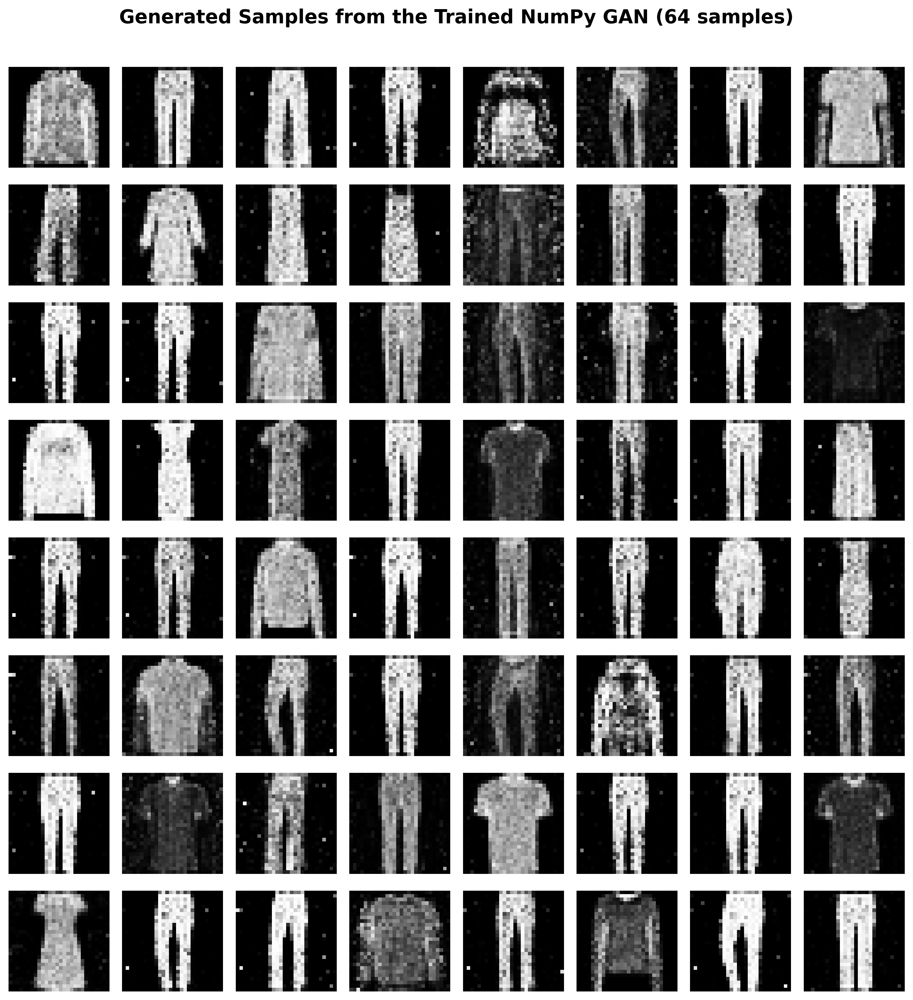
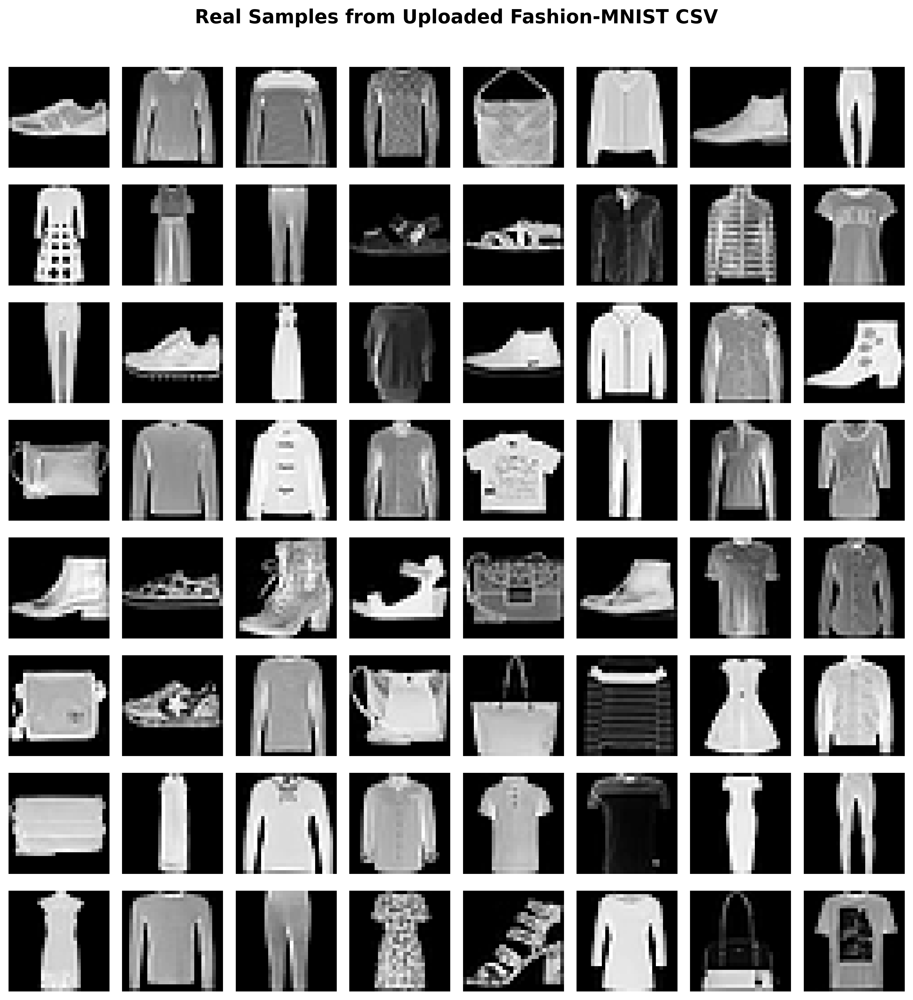
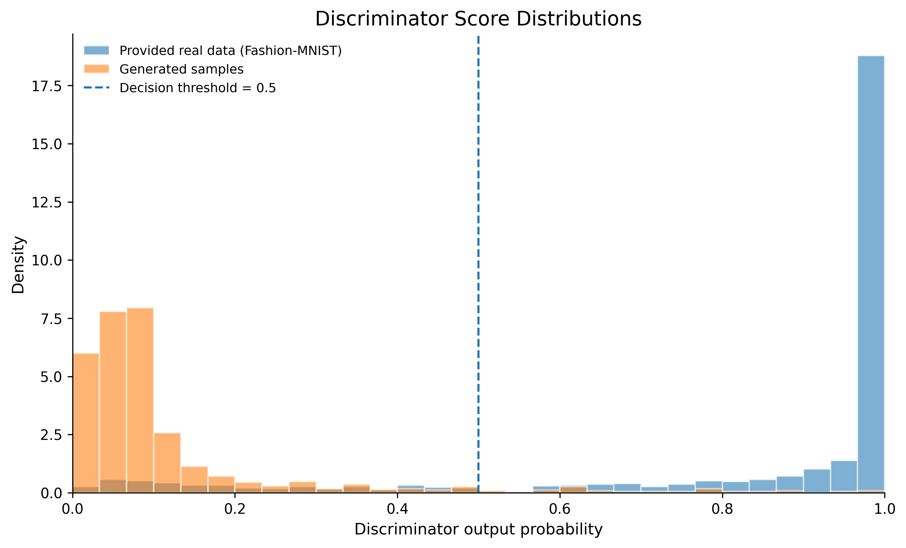
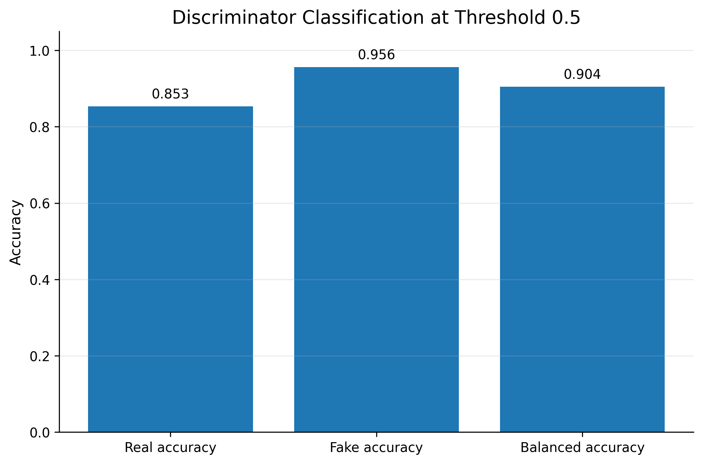
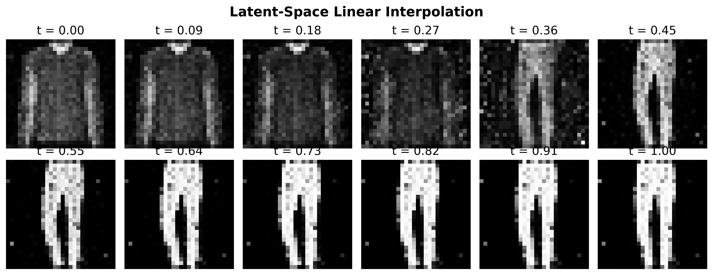
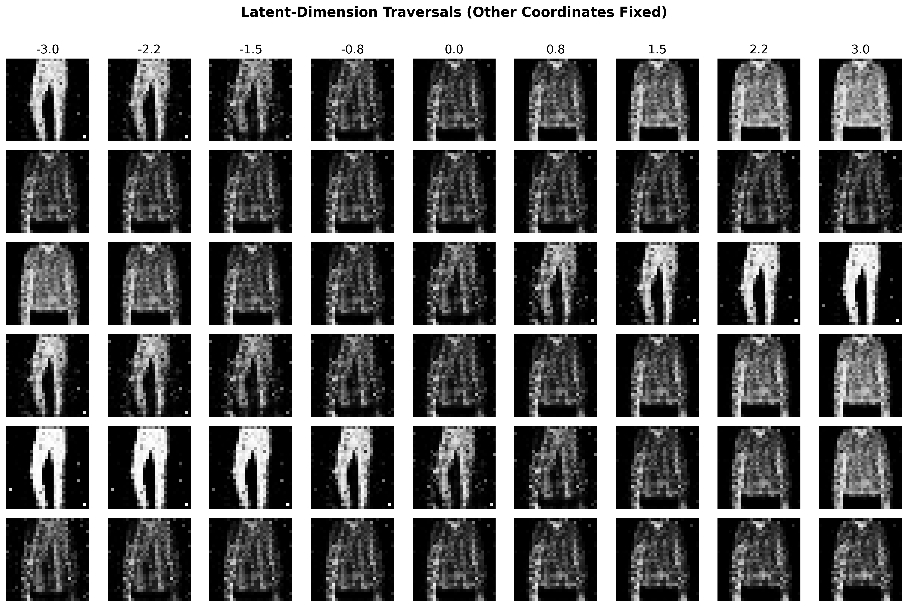
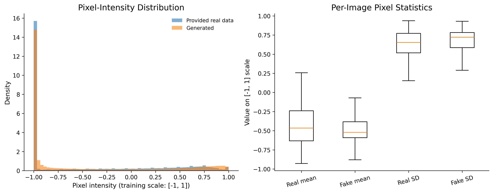

# GAN Pixel Lab
**[Open the GAN Lab](https://nawdeepbijarniya51-pixel.github.io/GAN_PIXEL_LAB/)**
A **Generative Adversarial Network built from scratch in pure NumPy** (no PyTorch, no TensorFlow) and trained on **Fashion-MNIST**. The repo covers the whole pipeline: hand-written forward and backward passes, an Adam optimizer, the adversarial training loop, a post-training evaluation suite, a FastAPI inference backend, and an interactive web frontend for exploring the trained generator.



<sub>64 samples drawn from the trained generator (see [Results](#results)).</sub>


---


## Table of Contents

- [Highlights](#highlights)
- [Project Structure](#project-structure)
- [Model Architecture](#model-architecture)
- [Training Setup](#training-setup)
- [Getting Started](#getting-started)
- [Interactive Frontend and API](#interactive-frontend-and-api)
- [Evaluation](#evaluation)
- [Results](#results)
- [Known Limitations](#known-limitations)
- [Roadmap](#roadmap)
- [References](#references)

---

## Highlights

- **Everything implemented manually:** dense layers, LeakyReLU, Sigmoid, Tanh, LayerNorm, Adam, and full backpropagation through both networks, all in NumPy.
- **Complete GAN loop:** alternating discriminator and generator updates with a binary cross-entropy objective and the non-saturating generator loss.
- **Trained checkpoint included:** `gan_weights_99.npz` holds all generator and discriminator weights.
- **Inference-only evaluation suite:** discriminator accuracy and score distributions, pixel-level diversity statistics, latent interpolation and traversal plots.
- **Live demo stack:** a FastAPI service that runs the generator in NumPy, and a single-page frontend with controls for seed, latent scale, gamma and output activation.
- **Automatic deployment:** a GitHub Actions workflow publishes the static pages to GitHub Pages on every push to `main`.

---

## Project Structure

```
GAN_PIXEL_LAB/
├── Generator.py              # Generator network (forward + backward)
├── Discriminator.py          # Discriminator network (forward + backward)
├── Activations.py            # LeakyReLU, Sigmoid, Tanh, LayerNorm
├── Adam.py                   # Adam optimizer
├── trainer.py                # Adversarial training loop + sample-grid saving
├── main.py                   # Entry point: loads data, builds models, trains
├── app.py                    # FastAPI inference backend
├── index.html                # Interactive frontend ("GAN Pixel Lab")
├── gan_weights_99.npz        # Trained generator + discriminator weights
├── fashion-mnist-samples.png # Reference samples from the real dataset
├── requirements.txt
├── evaluation/
│   ├── evaluate_gan.py              # Inference-only evaluation script
│   ├── index.html                   # Evaluation report page
│   ├── results_and_discussion.md    # Written analysis of the results
│   ├── evaluation_metrics.json/.csv # Numeric metrics
│   └── *.png                        # Generated figures
└── .github/workflows/static.yml     # GitHub Pages deployment
```

---

## Model Architecture

Both networks are fully connected (MLP) and operate on flattened 28×28 images scaled to `[-1, 1]`.

### Generator: 100 → 784

| Layer | Shape | Activation |
|-------|-------|------------|
| Dense 1 | 100 → 256 | LeakyReLU (0.2) |
| Dense 2 | 256 → 1024 | LayerNorm → LeakyReLU (0.2) |
| Dense 3 | 1024 → 512 | LeakyReLU (0.2) |
| Dense 4 | 512 → 784 | Tanh |

About **1.22 M** trainable parameters. Input is a latent vector `z ~ N(0, I)` of dimension 100.

### Discriminator: 784 → 1

| Layer | Shape | Activation |
|-------|-------|------------|
| Dense 1 | 784 → 1024 | LeakyReLU (0.2) |
| Dense 2 | 1024 → 512 | LayerNorm → LeakyReLU (0.2) |
| Dense 3 | 512 → 256 | LeakyReLU (0.2) |
| Dense 4 | 256 → 128 | LayerNorm → LeakyReLU (0.2) |
| Dense 5 | 128 → 1 | Sigmoid |

About **1.49 M** trainable parameters. The output is the probability that the input image is real.

### Implementation details

- **Initialization:** He-style normal initialization (`sqrt(2 / fan_in)`) for hidden layers, `sqrt(1 / fan_in)` for the output layer, zero biases.
- **LayerNorm:** row-wise normalization (`eps = 1e-8`) with a hand-derived backward pass.
- **Adam:** `beta1 = 0.5`, `beta2 = 0.999`, `eps = 1e-8`, with bias correction. Each network has its own optimizer state.

---

## Training Setup

| Setting | Value |
|---------|-------|
| Dataset | Fashion-MNIST training set (60,000 images) |
| Preprocessing | `pixel / 127.5 - 1` → range `[-1, 1]` |
| Batch size | 64 |
| Epochs | 100 |
| Learning rate (D and G) | 2e-4 |
| Latent dimension | 100 |
| Loss | Binary cross-entropy, with probabilities clipped to `[1e-7, 1 - 1e-7]` |

**Each training step:**

1. Sample a real batch and generate a fake batch from random noise.
2. Update D on the real batch (target 1) and then on the fake batch (target 0).
3. Update G with the non-saturating loss `-log D(G(z))`, back-propagating through D without updating it.

The trainer saves a 4×4 sample grid (`epoch_<n>.png`) and a checkpoint (`gan_weights.npz`, containing `G_*` and `D_*` arrays) every 5 epochs.

---

## Getting Started

### 1. Install

```bash
git clone https://github.com/nawdeepbijarniya51-pixel/GAN_PIXEL_LAB.git
cd GAN_PIXEL_LAB
python -m venv .venv
source .venv/bin/activate        # Windows: .venv\Scripts\activate
pip install -r requirements.txt
```

### 2. Train (optional, a trained checkpoint is included)

`main.py` reads the raw IDX file `train-images-idx3-ubyte` from the Fashion-MNIST dataset. Update the `DATA_DIR` constant at the top of `main.py` to point to the folder containing that file, then run:

```bash
python main.py
```

Progress is shown with `tqdm`, including the running discriminator and generator losses.

### 3. Run the API

```bash
uvicorn app:app --reload
```

The server loads `gan_weights_99.npz` by default. To use another checkpoint, set the `GAN_WEIGHTS_PATH` environment variable.

### 4. Open the frontend

`index.html` is a static page. Open it in a browser, or serve it locally:

```bash
python -m http.server 8080
```

The page calls the hosted API by default. To use your local server, change the `API_URL` constant in `index.html` to `http://127.0.0.1:8000/generate`.

---

## Interactive Frontend and API

The **GAN Pixel Lab** page lets you generate and inspect samples from the trained generator, and explains the dataset, architecture and training idea in plain language.

**Experiment controls**

| Control | Effect |
|---------|--------|
| Seed | Reproducible latent vector (`0 – 4294967295`) |
| Latent scale | Multiplies the latent vector (`0.1 – 2.5`) |
| Gamma | Contrast curve applied to output pixels (`0.4 – 2.5`) |
| Activation | Output nonlinearity, `tanh` or `sigmoid` |

### API reference

| Method | Endpoint | Description |
|--------|----------|-------------|
| `GET` | `/` | Service status |
| `GET` | `/health` | Reports whether generator weights are loaded |
| `POST` | `/generate` | Generates one 28×28 sample |

**Example request**

```bash
curl -X POST http://127.0.0.1:8000/generate \
  -H "Content-Type: application/json" \
  -d '{"seed": 42, "latent_scale": 1.0, "gamma": 1.0, "activation": "tanh"}'
```

**Response**

```json
{
  "seed": 42,
  "pixels": [0.0, 0.0, "... 784 values in [0, 1] ..."],
  "minimum": 0.0,
  "maximum": 0.98,
  "mean": 0.21
}
```

The API validates checkpoint shapes and finiteness at startup and refuses to start if the weights are malformed. Interactive API docs are available at `/docs` when running locally.

> The `sigmoid` option is an exploration control for the output mapping. The model was trained with a `tanh` output layer, so `tanh` is the faithful setting.

---

## Evaluation

The evaluation suite is **inference-only**: it loads the checkpoint, validates all 18 weight arrays, and runs forward passes. No optimizer is constructed and nothing is retrained.

```bash
pip install pandas scipy matplotlib numpy

python evaluation/evaluate_gan.py \
  --checkpoint gan_weights_99.npz \
  --fashion-csv path/to/fashion-mnist_train.csv \
  --out evaluation_output
```

Use `--mnist-idx path/to/train-images-idx3-ubyte` instead of `--fashion-csv` to evaluate against the raw IDX file. The default seed is `20261119`, and the script compares 1,000 real images against 1,000 generated ones.

**Outputs:** generated and real sample grids, discriminator score histograms, accuracy bars, latent interpolation, latent-coordinate traversals, pixel-distribution plots, and `evaluation_metrics.json/.csv`.

A full written analysis is in [`evaluation/results_and_discussion.md`](evaluation/results_and_discussion.md), and the same findings are presented as a web page in `evaluation/index.html`.

---

## Results

### Quantitative summary

| Metric | Value |
|--------|-------|
| Discriminator accuracy on real images | 85.3% |
| Discriminator accuracy on generated images | 95.6% |
| Balanced discriminator accuracy | 90.45% |
| Mean D score, real / generated | 0.841 / 0.116 |
| Mean per-pixel std across samples, real / generated | 0.546 / 0.432 |
| Mean pairwise L2 distance (500 samples), real / generated | 22.92 / 18.25 |
| Near-constant generated images (per-image std < 0.03) | 0% |

Reported training loss moved from 3.267 to 3.037 for the generator (minimum around 1.82) and from 0.423 to 0.471 for the discriminator.

### Visual results

| Generated | Real |
|-----------|------|
|  |  |

| Discriminator scores | Discriminator accuracy |
|----------------------|------------------------|
|  |  |

| Latent interpolation | Latent traversals |
|----------------------|-------------------|
|  |  |



### Interpretation

- The generator has learned **recognizable coarse structure**: trouser-like shapes and upper-body garments are clearly identifiable.
- Outputs are still **noisy, speckled and low in fine detail**, and the real data covers a wider range of categories with sharper edges.
- The discriminator separates real from fake well above chance, which indicates it is currently **stronger than the generator**.
- Generated samples show **lower diversity** than real ones (lower pixel variance and pairwise distances) and repeated trouser-like forms. This is a warning sign of **partial mode concentration**, not evidence of complete mode collapse.
- The latent space is **not uniformly semantic**: some coordinates change the output visibly, others barely at all.

---

## Known Limitations

- **Architecture:** MLP-based generator and discriminator. A convolutional (DCGAN-style) design would likely give sharper images.
- **No FID:** a standard Inception FID is a poor match for 28×28 grayscale images, and no Fashion-MNIST feature extractor was used, so no feature-based FID is reported.
- **Evaluation data:** the evaluation uses the training split, so discriminator accuracy is not a held-out generalization measure.
- **Checkpoint provenance:** the training loop saves every 5th epoch (indices 0, 5, …, 95) to `gan_weights.npz`, so `gan_weights_99.npz` was not produced by that exact save statement. Its shapes and values validate correctly, but it should not be assumed to be the final epoch-100 state without confirming how it was saved.
- **Hardcoded data path:** `main.py` uses a Windows-style `DATA_DIR` that must be edited for your machine.
- **Speed:** NumPy on CPU is educational rather than fast, so training for 100 epochs takes a while.

---

## Roadmap

- Convolutional generator and discriminator
- Class-conditional generation (cGAN) to control clothing category
- Domain-specific FID using a classifier trained on Fashion-MNIST
- Per-epoch loss logging and a training-dynamics plot
- Command-line arguments for `main.py` (data path, epochs, learning rate)
- Save a checkpoint at the final epoch

---

## References

- Goodfellow et al., *Generative Adversarial Networks*, 2014. [arXiv:1406.2661](https://arxiv.org/abs/1406.2661)
- Xiao, Rasul, Vollgraf, *Fashion-MNIST: a Novel Image Dataset for Benchmarking Machine Learning Algorithms*, 2017. [GitHub](https://github.com/zalandoresearch/fashion-mnist)
- Kingma and Ba, *Adam: A Method for Stochastic Optimization*, 2014. [arXiv:1412.6980](https://arxiv.org/abs/1412.6980)
- Ba, Kiros, Hinton, *Layer Normalization*, 2016. [arXiv:1607.06450](https://arxiv.org/abs/1607.06450)

---

## License

No license file is currently included. Add one (for example MIT) to state how others may use this code.
